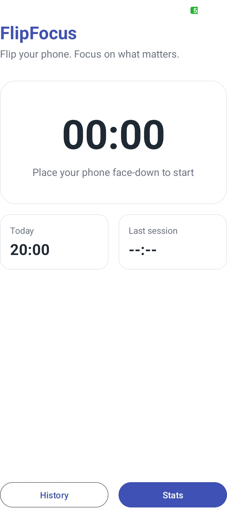
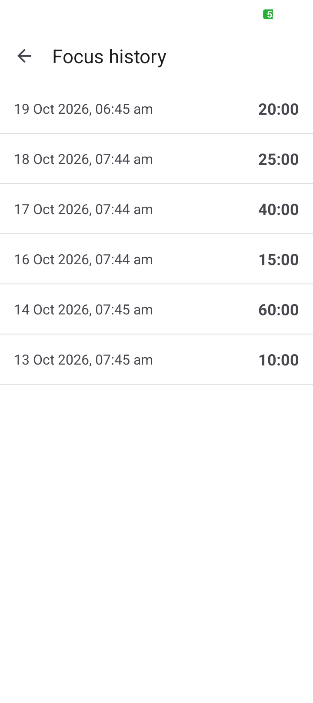
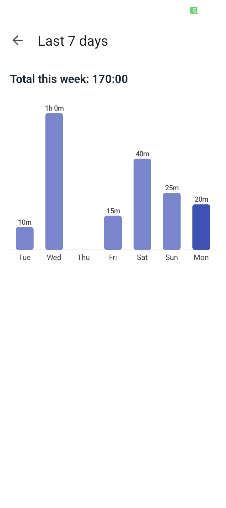
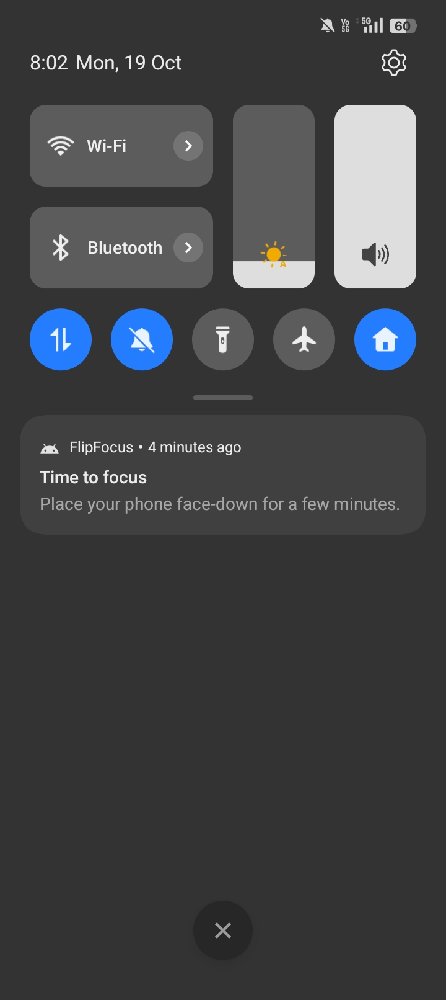

# FlipFocus

> Flip your phone. Focus on what matters.

FlipFocus is an offline Android app that measures how long you can leave your phone alone. Put the phone **face-down** and a focus timer starts automatically. Pick it up and the session is saved. A history list, a 7-day chart and a daily reminder help you build the habit.

Built with **Java** and **MVVM**. No account, no internet, no ads. All data stays on the device.

## Screenshots

| Home | History | Stats | Reminder |
|---|---|---|---|
|  |  |  |  |

## Demo

[Watch the 49-second demo video](https://youtube.com/shorts/UKwhgT5aOrg?feature=share)

## Download

[**Download the latest APK**](https://github.com/yazhinicodes/FlipFocus/releases/latest) (Android 8.0 or newer).
After downloading, allow "Install unknown apps" for your browser or file manager, then open the file.

## Features

- **Automatic focus timer.** The accelerometer detects when the phone lies face-down. No buttons to press.
- **Session history.** Every session of 10 seconds or more is saved in a local Room database and shown in a list, newest first.
- **7-day chart.** A bar chart drawn by hand with a custom View (no chart library), with a grow animation.
- **Daily reminder.** A notification at about 6 PM, scheduled with WorkManager. It survives app restarts and phone reboots.
- **Clean light UI** built with Material Components.

## How it works

- The accelerometer's z axis is about **+9.8** when the phone lies face-up and about **-9.8** when face-down.
- A session **starts** when z drops below **-8** and **stops** when z rises above **-6**. Using two different thresholds (hysteresis) prevents flickering when the phone is near the border.
- Duration is measured with `SystemClock.elapsedRealtime()` (it cannot jump if the user changes the clock). The start date is stored with `System.currentTimeMillis()`.
- Sessions shorter than 10 seconds are ignored, so accidental flips are not saved.

## Architecture

```
Activity / RecyclerView / BarChartView      <- UI: only shows data
              |  observes LiveData
          ViewModel                         <- holds screen data and rules
              |
          Repository                        <- single door to the data
              |
        Room DAO  ->  SQLite database

WorkManager -> ReminderWorker -> Notification
```

## Tech stack

- Java, Android SDK (min SDK 26)
- MVVM: `ViewModel`, `LiveData`
- Room (SQLite) with a Repository
- `RecyclerView` with `ListAdapter` and `DiffUtil`
- Custom `View` with `Canvas`, `Paint` and `ValueAnimator`
- WorkManager, notification channel, Android 13 notification permission
- Material Components
- JUnit 4 unit tests

## Project structure

```
com.yazhini.flipfocus
├── MainActivity, HistoryActivity, StatsActivity, SessionAdapter
├── data/        Session, SessionDao, AppDatabase, SessionRepository
├── viewmodel/   MainViewModel, HistoryViewModel, StatsViewModel
├── util/        TimeUtils, StatsCalculator (pure Java, unit tested)
├── view/        BarChartView (custom view)
└── work/        ReminderWorker, ReminderScheduler
```

## Engineering decisions

- **Hysteresis** (two thresholds) makes face-down detection stable.
- **No object allocation inside `onDraw`.** `Paint` and `RectF` are created once, and label strings are prepared before drawing, to avoid garbage-collection stutter.
- **The animator is cancelled in `onDetachedFromWindow`** so a running animation cannot leak the view.
- **Database writes run on a single-thread executor**, so the main thread is never blocked. Reads use `LiveData`, so screens update automatically.
- **`DiffUtil` through `ListAdapter`** updates only the rows that changed.
- **Business logic is plain Java** (`StatsCalculator`, `TimeUtils`), so it is tested without a device.
- **Unique periodic work with `KEEP`** means scheduling the reminder on every app start never creates duplicates.
- The chart has a `contentDescription`, so screen readers can announce the data.

## Tests

```
gradlew test        (Windows)
./gradlew test      (macOS / Linux)
```

15 unit tests cover time formatting and daily statistics, including the midnight boundary and sessions older than 7 days.

## Run from source

1. Clone the repository.
2. Open it in Android Studio.
3. Connect a **physical phone** with USB debugging turned on (the face-down sensor needs a real device).
4. Press **Run**.

## Known limitations and roadmap

- Pressing the power button ends the current session. A foreground service would fix this.
- The reminder time is fixed at about 6 PM. A setting to change it is planned.
- "Today" is calculated when the app starts and is not refreshed if the app stays open past midnight.
- Planned: daily goals and streaks, dark mode, data export, texts moved fully into `strings.xml`, dependency injection (Hilt).

## Author

**YAZHINI K**
LinkedIn: [https://www.linkedin.com/in/yazhini-k-61b8922a1] | Email: [yazhinikarnan05@gmail.com]
